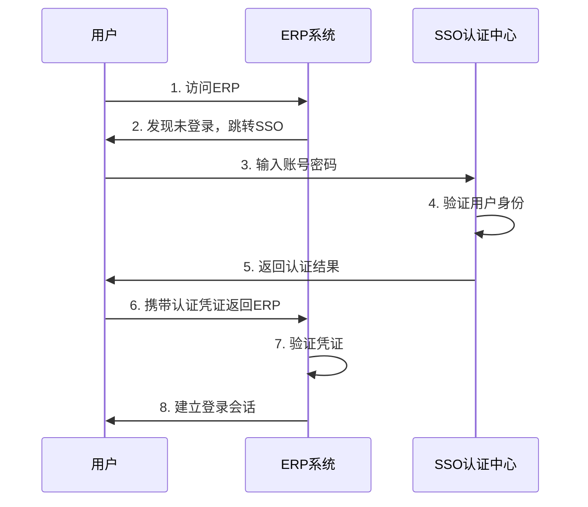

SSO（Single Sign-On），中文叫**单点登录**。

简单来说：**用户只需要登录一次，就可以访问多个不同的系统，而不需要每个系统都重新输入账号和密码。**

可以把它理解为：一个账号，登录整个公司的所有系统。

## 一、用一个例子理解 SSO

假设一家公司有以下系统：

- OA 办公系统
- ERP 企业资源管理系统
- CRM 客户管理系统
- BI 数据分析系统
- HR 人事管理系统

### 1. 传统登录方式

每个系统都有自己独立的账号和密码，用户访问不同系统时，需要重复登录。

```
用户
 ├── OA：输入账号密码
 ├── ERP：输入账号密码
 ├── CRM：输入账号密码
 └── BI：输入账号密码
```

缺点：

- 用户需要记住多个账号和密码。
- 不同系统之间的账号无法统一管理。
- 员工离职时，需要逐个系统禁用账号。

### 2. SSO 单点登录方式

通过建立一个统一身份认证中心，用户只需要登录一次，就可以访问多个业务系统。

```
             用户
              |
              v
       统一身份认证中心（SSO）
              |
       +------+------+------+
       |      |      |      |
       v      v      v      v
      OA     ERP    CRM    BI
```

例如：

早上登录公司的 OA 系统，下午打开 ERP 系统时，ERP 发现用户已经通过统一身份认证，就不需要再次输入账号密码。

**核心思想：一次登录，多系统访问。**

## 二、SSO 是怎么实现的？

SSO 的核心是增加一个统一身份认证中心。

这个中心通常称为：

- Identity Provider（IdP）：身份提供商。
- Service Provider（SP）：业务服务提供商。

其中：

- IdP：负责验证用户身份。
- SP：负责向 IdP 请求身份认证，并根据认证结果建立自己的登录会话。

### SSO 的基本流程



具体步骤：

1. **用户访问 ERP：** 用户打开 ERP，系统发现当前没有登录。
2. **跳转 SSO：** ERP 将用户重定向到统一身份认证中心。
3. **身份验证：** 用户输入账号和密码，SSO 验证用户身份。
4. **生成认证凭证：** 验证成功后，SSO 生成相应的认证结果。
5. **返回 ERP：** 用户携带认证凭证返回 ERP。
6. **建立登录会话：** ERP 验证凭证有效后，为用户建立自己的登录会话。
7. **访问其他系统：** 用户再访问 CRM 时，CRM 也接入同一个 SSO，通常无需重新输入密码。

注意：实际协议中可能使用授权码、ID Token、断言等不同机制，并不都是直接将 Token 传回业务系统。

## 三、SSO 涉及哪些技术？

在后端开发中，需要理解以下几个概念：

| 技术      | 全称                               | 主要作用     | 简单理解            |
| --------- | ---------------------------------- | ------------ | ------------------- |
| OAuth 2.0 | Open Authorization 2.0             | 授权         | 允许应用访问资源    |
| OIDC      | OpenID Connect                     | 身份认证     | 确认用户是谁        |
| SAML 2.0  | Security Assertion Markup Language | 身份认证     | 企业常用的 SSO 协议 |
| JWT       | JSON Web Token                     | 身份信息载体 | 一种 Token 格式     |
| CAS       | Central Authentication Service     | 单点登录     | 经典的 SSO 协议     |

### 重点区分

**1. OAuth 2.0**

主要解决授权问题。

例如：允许第三方应用访问用户授权的资源。

**2. OIDC**

建立在 OAuth 2.0 之上，主要解决身份认证问题。

例如：通过统一认证中心确认当前用户是谁。

**3. JWT**

是一种 Token 格式，可以携带用户身份等声明信息。

例如：

```
{
  "sub": "10001",
  "username": "zhangsan",
  "role": "admin",
  "exp": 1799999999
}
```

注意：JWT 只是 Token 的一种格式，并不是 SSO 协议。

**4. SAML 2.0**

主要用于企业级身份认证，常见于企业内部系统与第三方身份平台集成。

**5. CAS**

一种经典的单点登录解决方案，常见于高校和企业内部系统。

## 四、企业级 ERP 为什么需要 SSO？

假设正在开发一个企业级 ERP，未来公司可能还有：

- OA 办公系统
- CRM 客户管理系统
- MES 制造执行系统
- WMS 仓储管理系统
- BI 数据分析系统

这些系统如果各自维护账号体系，会增加管理成本。

SSO 可以解决以下问题：

| 问题         | SSO 的解决方式                     |
| ------------ | ---------------------------------- |
| 账号太多     | 建立统一账号体系                   |
| 重复登录     | 一次登录，多系统访问               |
| 员工离职     | 统一禁用身份账号，减少权限残留     |
| 权限管理混乱 | 统一身份认证，业务系统独立管理权限 |
| 安全审计     | 集中记录认证行为                   |

### 一个非常重要的设计原则

**SSO 负责确认你是谁，各个业务系统负责判断你能做什么。**

例如：

| 系统 | 负责的事情               |
| ---- | ------------------------ |
| SSO  | 确认当前用户是员工张三   |
| ERP  | 判断张三能否查看采购订单 |
| CRM  | 判断张三能否查看客户信息 |
| OA   | 判断张三能否审批请假申请 |

也就是说：

- 身份认证（Authentication）：你是谁？
- 权限授权（Authorization）：你能做什么？

SSO 不代表所有系统的权限都一样。

## 五、实际开发可以使用什么？

如果要开发企业级 ERP，可以考虑以下身份认证平台。

### 1. Keycloak

官方网站：https://www.keycloak.org/

特点：

- 开源身份认证平台。
- 支持 SSO。
- 支持 OAuth 2.0。
- 支持 OpenID Connect（OIDC）。
- 支持 SAML 2.0。
- 支持用户、角色和权限管理。

**推荐程度：高。**

适合企业内部多个系统统一身份认证。

### 2. Auth0

官方网站：https://auth0.com/

特点：

- 托管式身份认证服务。
- 支持 OAuth 2.0 和 OIDC。
- 提供多种身份认证方式。
- 可以减少自己维护认证基础设施的工作量。

适合不想自己部署和维护身份认证中心的团队。

### 3. Casdoor

官方网站：https://casdoor.org/

特点：

- 开源身份认证平台。
- 支持多种认证协议。
- 支持用户和组织管理。
- 可以用于企业统一登录。

适合希望使用开源方案搭建身份认证系统的团队。

## 六、实际项目应该如何选择？

如果开发企业级 ERP，我比较推荐：

**Keycloak + Spring Boot + OIDC**

整体架构：

```
                  用户
                   |
                   v
             前端登录页面
                   |
                   v
          Keycloak 身份认证中心
                   |
              OIDC 协议
                   |
        +----------+----------+
        |          |          |
        v          v          v
       ERP        CRM        OA
        |          |          |
        v          v          v
    Spring Boot Spring Boot Spring Boot
        |          |          |
        v          v          v
      ERP权限     CRM权限     OA权限
```

各个组件的职责：

| 组件        | 主要职责                       |
| ----------- | ------------------------------ |
| Keycloak    | 统一身份认证、登录、Token 签发 |
| OIDC        | 统一身份认证协议               |
| Spring Boot | 各业务系统的后端服务           |
| JWT         | 可以用于承载身份和权限声明     |
| RBAC        | 各业务系统的角色权限控制       |

## 七、最后总结

理解 SSO，只需要记住三个问题：

1. **SSO 是什么？**

   单点登录，一次登录即可访问多个业务系统。

2. **SSO 解决什么问题？**

   统一账号、减少重复登录、集中管理身份认证。

3. **SSO 和权限管理有什么区别？**

   SSO 负责认证用户身份，RBAC 等权限体系负责控制用户可以访问哪些功能。

### 推荐学习顺序

```
第一步：理解 HTTP Session 和 Cookie
          |
          v
第二步：理解 Token 和 JWT
          |
          v
第三步：理解 OAuth 2.0 和 OIDC
          |
          v
第四步：理解 SSO 单点登录流程
          |
          v
第五步：学习 Keycloak 实际部署
          |
          v
第六步：使用 Spring Boot 集成 Keycloak
          |
          v
第七步：结合 RBAC 实现企业级权限管理
```

**我的建议：** 如果你的目标是开发企业级 ERP，不要只停留在理解 SSO 的概念，最好实际部署一次 Keycloak，并让两个独立的 Spring Boot 系统共享同一个身份认证中心。这样就能真正理解企业级统一登录的实现原理。